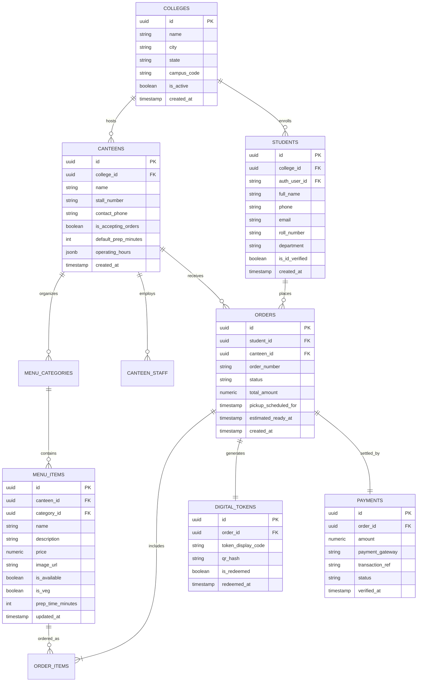

# QuickBite — System Architecture Specification

> **Document Version:** 1.3.0  
> **Last Updated Milestone:** 08 — Student Mobile App Foundation & Native Android Build  
> **Status:** Architectural Baseline — Active Development  

---

## 1. System Overview

QuickBite is an event-driven, real-time client-server platform designed for high-concurrency burst workloads typical of college campus dining hours. The architecture leverages a monorepo structure housing a React Native / Expo mobile client, a React / TypeScript business dashboard, shared validation logic, and a cloud-native Supabase (PostgreSQL 15+) backend.

```mermaid
graph TD
    subgraph Clients["Client Applications"]
        StudentApp["Student Mobile App<br/>(React Native / Expo)"]
        BizDash["Business Dashboard<br/>(React / TypeScript)"]
    end

    subgraph Edge["Gateway & Edge Layer"]
        SupabaseAuth["Supabase Auth<br/>(Phone OTP / JWT)"]
        EdgeFuncs["Supabase Edge Functions<br/>(Deno / TypeScript)<br/>- UPI Webhook Verification<br/>- OCR Document Extraction"]
    end

    subgraph Realtime["Synchronization Layer"]
        SupabaseRealtime["Supabase Realtime Engine<br/>(WebSockets / PostgreSQL CDC)"]
    end

    subgraph Data["Database & Storage Layer"]
        PostgreSQL[("PostgreSQL 15+ Database<br/>- Row Level Security (RLS)<br/>- Stored Procedures & Triggers")]
        Storage[("Supabase Storage<br/>- Food Photography<br/>- Encrypted ID Cards")]
    end

    subgraph External["External Services"]
        UPIProviders["UPI PSP Apps<br/>(GPay, PhonePe, Paytm, CRED)"]
        OCRService["OCR Engine<br/>(ML Vision Extraction)"]
    end

    StudentApp -->|GraphQL / REST / JWT| PostgreSQL
    StudentApp -->|Subscribe Order Updates| SupabaseRealtime
    StudentApp -->|Deep-Link Payment Intent| UPIProviders
    StudentApp -->|Upload ID Scan| EdgeFuncs

    BizDash -->|REST / JWT| PostgreSQL
    BizDash -->|Subscribe Live KDS Queue| SupabaseRealtime

    EdgeFuncs -->|Verify Webhooks / S2S| UPIProviders
    EdgeFuncs -->|Process Extraction| OCRService
    EdgeFuncs -->|Direct Mutations| PostgreSQL

    PostgreSQL -->|Change Data Capture (CDC)| SupabaseRealtime
```

---

## 2. Monorepo Organization & npm Workspaces Architecture

### 2.1. Rationale: Why QuickBite Uses a Monorepo
QuickBite is an interconnected ecosystem comprising a cross-platform consumer mobile app, a kitchen operator dashboard, shared domain logic, and a cloud-native database backend. A monorepo configuration delivers distinct operational advantages:
1. **Single Source of Truth for Domain Contracts:** Eliminates data drift between the student ordering frontend and the kitchen management backend by sharing Zod schemas, TypeScript interfaces, and order state definitions directly from `packages/shared`.
2. **Atomic Schema Evolution:** When a database migration alters order or menu schemas, both client applications and shared types are updated in a single atomic commit, eliminating version mismatches.
3. **Consolidated Tooling & Standards:** Enforces uniform formatting via `.editorconfig`, unified TypeScript baseline rules via `tsconfig.base.json`, and centralized CI/CD scripts without managing independent package registries or private npm feeds.

### 2.2. npm Workspaces Configuration
The root repository is configured as an npm workspaces monorepo via `package.json` (`name: "quickbite-workspace"`):

```json
{
  "name": "quickbite-workspace",
  "version": "0.1.0",
  "private": true,
  "workspaces": [
    "apps/*",
    "packages/*"
  ],
  "engines": {
    "node": ">=20.0.0",
    "npm": ">=10.0.0"
  }
}
```

```text
QUICKBITE/
├── package.json              # Monorepo root manifest (npm workspaces definition)
├── tsconfig.base.json        # Shared baseline TypeScript compiler options
├── .editorconfig             # Universal cross-editor formatting specifications
├── apps/
│   ├── student-app/          # [ACTIVE — Native Dev Build & Expo Go] Mobile client (React Native 0.88.1 + Expo SDK 58)
│   └── business-dashboard/   # [PLANNED] Web SPA for canteen operators (React + TypeScript)
├── packages/
│   └── shared/               # [IMPLEMENTED] @quickbite/shared (Zod 4 schemas, enums, & inferred types)
├── supabase/
│   ├── migrations/           # [PLANNED] Versioned SQL migrations (RLS, schema, triggers)
│   ├── functions/            # [PLANNED] Serverless Edge Functions (Deno / TypeScript)
│   └── seed/                 # [PLANNED] Development seed datasets (campuses, menus)
├── docs/                     # Architectural, product, and design specifications
└── design/                   # Brand tokens, UI references, and exports
```

### 2.3. Workspace Boundaries & Responsibilities

| Workspace / Directory | Target Technology | Scope & Responsibilities | Dependencies & Architectural Boundaries |
| :--- | :--- | :--- | :--- |
| **`apps/student-app`** | React Native 0.88.1, Expo SDK 58, TypeScript | [ACTIVE — Native Dev Build & Expo Go] Student consumer app: OTP authentication, OCR ID scanning, menu discovery, cart, UPI payments, live digital token tracking. Verified via native development build (Expo CNG) on Android Studio emulator and via Expo Go on physical device. Full QuickBite application UI is planned for upcoming milestones. | Consumes `@quickbite/shared`. Never imports dashboard code. Retains Expo's dedicated `tsconfig.json`. |
| **`apps/business-dashboard`** | React, TypeScript (Vite) | [PLANNED] Kitchen & admin portal: Live Kitchen Display System (KDS), menu availability toggling, sales analytics. | Consumes `@quickbite/shared`. Never imports mobile app code. |
| **`packages/shared`** | TypeScript + Zod 4 | [IMPLEMENTED] Domain interfaces, order status enums, Zod validation schemas, business constants, currency formatters. | Zero UI or framework dependencies. Extends `tsconfig.base.json`. Consumed directly via npm workspace linking. |
| **`supabase/`** | PostgreSQL 15+, Deno | [PLANNED] Cloud backend: SQL DDL migrations, Row Level Security (RLS) rules, seed fixtures, and Deno Edge Functions. | Decoupled from the Node.js workspace hierarchy; managed via Supabase CLI and SQL tooling. |

> [!NOTE]
> *Implementation Status:* The shared package `@quickbite/shared` is implemented and linked via npm workspaces. The student app (`apps/student-app`) is **ACTIVE** — initialized with Expo SDK 58 and React Native 0.88.1, configured with full native Android build toolchain (SDK 37, JDK 17, CMake 3.31.6, Ninja 1.12.1), passed 20/20 Expo Doctor checks, and verified on the Android Studio emulator. Full QuickBite application UI screens are planned for upcoming milestones. The business dashboard and Supabase migrations remain planned.

### 2.4. Monorepo Development Workflow
The root workspace provides unified orchestration scripts executing recursively across available packages using npm's `--workspaces --if-present` flags:
* **`npm run typecheck`**: Executes type checking across all workspace packages defining a `typecheck` script without failing on packages that omit it.
* **`npm run lint`**: Executes static code linting across all workspace packages defining a `lint` script.
* **`npm run test`**: Runs unit and integration test runners across all workspace packages defining a `test` script.

### 2.5. Baseline TypeScript Architecture (`tsconfig.base.json`)
The root `tsconfig.base.json` provides a shared configuration for Node/TypeScript packages (such as `packages/shared`):
* **Target & Library:** `ES2022` target with modern ECMAScript feature support.
* **Module Resolution:** `module: "ESNext"` paired with `"moduleResolution": "bundler"` for modern packaging and bundler compatibility.
* **Type Safety:** `"strict": true`, `"forceConsistentCasingInFileNames": true`, `"skipLibCheck": true`.
* **Zero Overhead:** `"noEmit": true` preventing unintended code generation at the root level.
* **Expo Independence:** The student mobile app in `apps/student-app` is intentionally not bound to this base configuration; it will extend Expo's official `@expo/tsconfig.base` upon app scaffolding to guarantee seamless Metro bundler integration.

### 2.6. Shared Package Architecture (`@quickbite/shared`)

#### Purpose
`@quickbite/shared` is a source-first, framework-agnostic TypeScript package that acts as the single source of truth for all domain entities, validation rules, enums, and data transfer objects (DTOs) across the QuickBite monorepo.

#### Why Zod 4 is Used
* **Unified Schema & Type Definition:** Eliminates duplication by defining validation logic once and inferring static TypeScript types via `z.infer`.
* **Runtime Boundary Safety:** Provides foolproof parsing and validation at network boundaries (REST requests, WebSocket messages, client form submissions).
* **Zero Client Framework Binding:** Operates cleanly in React Native (Expo Metro), React Web (Vite), and serverless Edge Functions (Deno).
* **Lightweight & Fast:** Zod 4 delivers a streamlined footprint with near-zero runtime overhead when schemas are parsed.

#### Domain Schema Organisation
```text
packages/shared/src/
├── index.ts                  # Public package entry point
├── schemas/
│   ├── index.ts              # Schema barrel export
│   ├── common.ts             # UUIDs, ISO timestamps, currency, domain enums
│   ├── college.ts            # College entity, create & update schemas
│   ├── canteen.ts            # Canteen entity, create & update schemas
│   ├── student.ts            # Student profile schema (privacy-compliant)
│   ├── menu-item.ts          # Menu item catalog schemas (prices in integer paise)
│   ├── order.ts              # Order and OrderItem schemas, cross-field refinements, totals
│   ├── token.ts              # Digital token number and status schemas
│   └── payment.ts            # Payment record and status schemas
└── types/
    └── index.ts              # Inferred TypeScript types via z.infer
```

#### Cross-Field Validation Refinements (Milestone 07 — Audit Resolution)
`order.ts` enforces two critical cross-field invariants using Zod `.refine()`:

1. **Order Item Total Integrity** — Ensures `totalPricePaise === quantity × unitPricePaise` for every line item. Prevents mismatched price snapshots from reaching the checkout stage:
```typescript
orderItemSchema.refine(
  (item) => item.totalPricePaise === item.quantity * item.unitPricePaise,
  { message: 'totalPricePaise must equal quantity multiplied by unitPricePaise', path: ['totalPricePaise'] }
)
```

2. **Order Subtotal Integrity** — Ensures `subtotalPaise === sum(items[].totalPricePaise)`. Guards against subtotal drift across line-item additions or server-side mutations:
```typescript
orderSchema.refine(
  (order) => order.subtotalPaise === order.items.reduce((sum, item) => sum + item.totalPricePaise, 0),
  { message: 'subtotalPaise must equal the sum of all item totalPricePaise values', path: ['subtotalPaise'] }
)
```

> [!NOTE]
> `totalPaise` is intentionally preserved alongside `subtotalPaise` to accommodate future checkout breakdowns (e.g. convenience fees, packaging charges, applied discounts, GST). These breakdown fields will be introduced during payment workflow implementation (planned Milestone 11/12). The divergence between `subtotalPaise` and `totalPaise` is not validated at this stage.

#### Application Consumption Pattern
Both consumer and business applications consume shared definitions directly via the workspace alias:
```typescript
import {
  orderSchema,
  type Order,
  type OrderStatus,
  orderStatusSchema,
  createOrderInputSchema,
} from '@quickbite/shared';

// Parse incoming WebSocket or REST payload — includes cross-field refinements
const validatedOrder: Order = orderSchema.parse(rawPayload);
```

#### Distinction: Shared Schemas vs. Supabase Database Validation
It is critical to distinguish application-layer validation from future database-layer enforcement:
1. **`@quickbite/shared` (Application Layer):** Validates user input before network transmission and verifies API responses at runtime within the client apps. Enforces business formats (regex for Indian phone numbers, character lengths, integer paise currency), and cross-field arithmetic invariants (item total, subtotal sum).
2. **Supabase / PostgreSQL (Database Layer - Upcoming):** Enforces relational referential integrity (`FOREIGN KEY`), transactional isolation, check constraints (e.g. `CHECK (total_paise >= 0)`), Row Level Security (RLS) policies, and immutable audit triggers. Shared schemas do not replace database constraints; they complement them by catching malformed data at the client perimeter before it reaches the database.

### 2.7. Student Application Architecture (`apps/student-app`)

#### Status
**ACTIVE — Native Android Development Build & Expo Go.**
- Native development build installation verified on **Android Studio emulator**.
- Early JavaScript bundle testing verified on physical Android device via **Expo Go**.
- *Constraints:* No physical-device native installation claimed; no production APK/AAB readiness claimed (release signing, code shrinking/minification, and Play Store distribution are deferred to Milestone 15).

#### Native Build Toolchain & Environment
The native Android development build was compiled using Expo Continuous Native Generation (CNG):
- **Expo CNG Workflow:** `npx expo prebuild` / `expo run:android` generates ephemeral native Android project files that are excluded from version control via `.gitignore`.
- **Android SDK:** API Level 37 (Target & Compile SDK) with Android Build Tools.
- **Java Development Kit:** JDK 17 (Eclipse Temurin / OpenJDK 17).
- **Native Build Tools:** CMake 3.31.6 and Ninja 1.12.1 for C++ compilation and React Native New Architecture worklets.
- **Windows Path Resolution:** Windows long-path limitation resolved (`core.longpaths = true` and shortened build output paths) to support deeply nested React Native and CMake intermediate artifacts.
- **Diagnostics & Governance:** Passed 20/20 checks on `npx expo-doctor` with zero errors or warnings.

#### Execution Environment & Distribution Distinction
| Dimension | Expo Go (Early Testing) | Native Development Build (Milestone 08) | Standalone APK / AAB (Production Milestone 15) |
| :--- | :--- | :--- | :--- |
| **Verification Target** | Physical Android device | **Android Studio emulator** | Physical Android devices / Play Store |
| **Execution Model** | JS bundle in Expo Go app container | Full native compilation via Expo CNG | Standalone optimized native binary |
| **Package Identifier** | Generic Expo Go host identity | `com.quickbite.student` | `com.quickbite.student` (Play Store verified) |
| **Native Modules** | Restricted to Expo Go standard set | All native libraries, CMake C++ worklets | All native libraries & custom extensions |
| **Build Tooling** | Expo Go app (no local compiler needed) | Android SDK 37, JDK 17, CMake 3.31.6, Ninja 1.12.1 | Expo EAS Build / CI release pipeline |
| **Production Readiness**| ❌ No (development container only) | ❌ No (debug development build only) | ✅ Yes (signed release AAB/APK) |

#### Application Identity
Configured in `apps/student-app/app.json`:

| Field | Value | Notes |
| :--- | :--- | :--- |
| `name` | `QuickBite` | Application display name |
| `slug` | `quickbite-student` | Expo project slug (URL-safe) |
| `scheme` | `quickbite` | Deep-linking URI scheme (`quickbite://`) |
| `orientation` | `portrait` | Portrait-locked for optimal order flow UX |
| `userInterfaceStyle` | `light` | Light mode enforced — QuickBite brand is light-first |
| `android.package` | `com.quickbite.student` | **Provisional** — verify uniqueness on Google Play Console before production publishing |

#### Framework & Runtime
| Attribute | Value |
| :--- | :--- |
| **Expo SDK** | 58 (`~58.0.23`) |
| **React Native** | 0.88.1 |
| **React** | 19.3.0 |
| **Navigation** | Expo Router (`~58.0.30`, file-based routing) |
| **Source root** | `apps/student-app/src/` |
| **Entry Point** | `main: "expo-router/entry"` in `package.json` |
| **Shared Domain** | `@quickbite/shared` (`^0.1.0`, npm workspace link) |

#### Directory Structure
```text
apps/student-app/
├── app.json                        # Official application identity (QuickBite, com.quickbite.student)
├── package.json                    # App-level dependencies (Expo SDK 58, React Native 0.88.1)
├── tsconfig.json                   # Extends @expo/tsconfig.base (independent from root)
├── expo-env.d.ts                   # Expo Router typed routes declaration
├── src/
│   ├── app/                        # Expo Router file-based screen routes
│   │   ├── _layout.tsx             # Root navigator: ThemeProvider, AnimatedSplashOverlay, AppTabs
│   │   ├── index.tsx               # Home tab (Expo starter screen — to be replaced)
│   │   └── explore.tsx             # Explore tab (Expo starter screen — to be replaced)
│   ├── components/
│   │   ├── animated-icon.tsx       # Animated Expo logo icon (starter)
│   │   ├── app-tabs.tsx            # Tab bar navigator component
│   │   ├── external-link.tsx       # Pressable external link wrapper
│   │   ├── hint-row.tsx            # Hint display row (starter)
│   │   ├── themed-text.tsx         # Theme-aware Text component
│   │   ├── themed-view.tsx         # Theme-aware View component
│   │   ├── web-badge.tsx           # Expo web badge (web platform only)
│   │   └── ui/
│   │       └── collapsible.tsx     # Reanimated-powered collapsible (starter)
│   ├── constants/
│   │   └── theme.ts                # Colour tokens, Spacing, Fonts, BottomTabInset, MaxContentWidth
│   ├── hooks/
│   │   ├── use-color-scheme.ts     # Device color scheme hook
│   │   └── use-theme.ts            # Active theme object hook
│   └── global.css                  # Global stylesheet (NativeWind/CSS Interop ready)
├── assets/
│   ├── images/                     # App icons, splash, tab icons, tutorial images
│   └── expo.icon/                  # iOS adaptive icon assets
└── scripts/
    └── reset-project.js            # Expo new-project reset utility
```

#### Navigation Architecture
- **Entry Point:** `expo-router/entry` (defined in `package.json`)
- **Root Layout** (`src/app/_layout.tsx`): Renders `ThemeProvider` (Expo Router) wrapping `AnimatedSplashOverlay` and the `AppTabs` tab navigator.
- **Tab Navigator** (`src/components/app-tabs.tsx`): Provides bottom tab navigation between `index` (Home) and `explore` screens.
- **Screens (current — Expo starter, to be replaced):**
  - `src/app/index.tsx` — Home screen with Expo animated icon and development hints.
  - `src/app/explore.tsx` — Expo feature showcase screen.

> [!IMPORTANT]
> Existing Expo starter screens (`index.tsx`, `explore.tsx`) are **not** production QuickBite screens. They are preserved as the app development baseline. Full QuickBite UI (canteen discovery, menu, cart, order tracking) will replace them in upcoming milestones.

#### Key Dependencies (`apps/student-app`)
| Package | Version | Purpose |
| :--- | :--- | :--- |
| `expo` | ~58.0.23 | Expo SDK platform runtime |
| `expo-router` | ~58.0.30 | File-based navigation |
| `expo-splash-screen` | ~58.0.13 | Animated launch screen |
| `react-native-reanimated` | 4.7.1 | UI-thread 60 FPS animations |
| `react-native-gesture-handler` | ~3.3.0 | Native gesture system |
| `@expo/ui` | ~58.0.27 | Expo UI components |
| `expo-image` | ~58.0.18 | Optimized image rendering |
| `@quickbite/shared` | ^0.1.0 | Workspace-linked domain schemas |

---

## 3. Data Architecture & Entity Relationship Model

The database schema is modeled around campus multi-tenancy, multi-stall canteens, catalog versioning, and real-time order state lifecycles:



---

## 4. Real-time Order State Machine

Order state management follows a deterministic finite state machine (FSM) enforced via PostgreSQL check constraints and triggers:

```mermaid
stateDiagram-v2
    [*] --> PLACED: Student checkout & UPI authorization confirmed
    PLACED --> ACCEPTED: Kitchen acknowledges order
    PLACED --> CANCELLED: Out of stock / Auto-timeout / Refund
    ACCEPTED --> PREPARING: Kitchen staff taps "Start Cooking"
    PREPARING --> READY_FOR_PICKUP: Dish prepared; Student notified via haptic/push
    READY_FOR_PICKUP --> COMPLETED: Token scanned & meal collected
    ACCEPTED --> CANCELLED: Unexpected disruption / Kitchen cancellation
    READY_FOR_PICKUP --> CANCELLED: Student uncollected timeout (Edge case)
    COMPLETED --> [*]
    CANCELLED --> [*]
```



### State Definitions & Trigger Behaviors
1. **`PLACED`**: Initial state generated upon successful payment webhook callback. Token created with `is_redeemed = false`.
2. **`ACCEPTED`**: Canteen staff taps "Accept" on KDS. Dynamic preparation timer begins countdown.
3. **`PREPARING`**: Kitchen designates that the order is actively being assembled/cooked.
4. **`READY_FOR_PICKUP`**: Chef marks food ready. Triggers real-time notification, haptic pattern on student phone, and mint green screen glow.
5. **`COMPLETED`**: Canteen counter scans QR code or verifies numeric token. Order is marked archived and immutable.
6. **`CANCELLED`**: Terminal state initiating automated UPI reversal workflow.

---

## 5. Integration Architecture

### 5.1. UPI Payment Integration Flow
To guarantee sub-second checkout speed for Indian students, QuickBite adopts an **Intent Deep-Linking + Server Webhook Verification** flow:
1. Student confirms cart; client requests an order payment intent from Supabase Edge Function `create-payment-intent`.
2. Edge function generates a verifiable payment session with a unique reference (`TXN_...`).
3. Client triggers Android UPI Intent chooser (Google Pay, PhonePe, Paytm, CRED).
4. Student authorizes transaction with UPI PIN in their preferred banking application.
5. Payment Gateway dispatches cryptographic webhook to `verify-payment-webhook` Supabase Edge Function.
6. Function verifies signature, updates `orders.status` to `PLACED`, and issues the digital token via atomic SQL transaction.

### 5.2. OCR College ID Processing Pipeline
1. Student captures ID card using React Native camera component with rectangular viewfinder bounds.
2. Image is compressed on-device (< 350 KB WebP) and transmitted to the `extract-student-id` Edge Function.
3. Edge Function runs text recognition to isolate Name, Roll No., and Department.
4. Extracted payload returns to client for instant student confirmation and profile auto-fill.

---

## 6. Real-time Synchronization Architecture

QuickBite utilizes **Supabase Realtime** backed by PostgreSQL Change Data Capture (CDC):

* **Channel: `canteen:{canteen_id}:kitchen`**
  * Subscribed to by the Business Dashboard KDS.
  * Receives instantaneous payloads when new rows appear in `orders` where `canteen_id = :id` and `status = 'PLACED'`.
* **Channel: `order:{order_id}:student`**
  * Subscribed to by the Student App Active Order screen.
  * Receives updates on `status`, `estimated_ready_at`, and preparation progress rings.
* **Presence Channel: `canteen:{canteen_id}:occupancy`**
  * Lightweight tracking of active in-queue students to calculate real-time queue congestion indices.

---

## 7. Security & Compliance Architecture

* **PostgreSQL Row Level Security (RLS):**
  * Students can only read and write their own orders, tokens, and profiles.
  * Canteen staff can only view and mutate orders belonging to their assigned canteen.
  * Public access is strictly restricted to active menu items and canteen profiles.
* **Cryptographic Token Verification:**
  * Tokens contain a HMAC-SHA256 hash incorporating the `order_id`, `student_id`, and `canteen_salt`.
  * Scanning verifies the hash server-side to prevent counterfeiting or duplicated chits.
* **Environment Isolation:**
  * Strict separation of credentials via environment variables (`.env.example` template provided; actual secrets never checked into Git).
