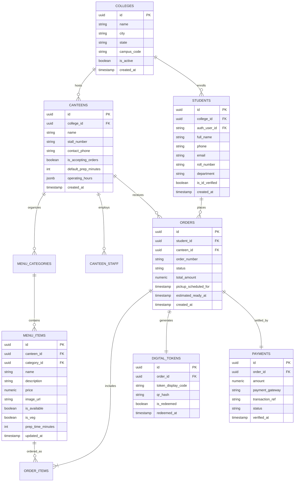

# QuickBite — System Architecture Specification

> **Document Version:** 1.0.0  
> **Milestone:** 03 — Official Project Documentation  
> **Status:** Architectural Baseline  

---

## 1. System Overview

QuickBite is an event-driven, real-time client-server platform designed for high-concurrency burst workloads typical of college campus dining hours. The architecture leverages a monorepo structure housing a React Native / Expo mobile client, a React / TypeScript business dashboard, shared validation logic, and a cloud-native Supabase (PostgreSQL 15+) backend.

```mermaid
graph TD
    subgraph Clients["Client Applications"]
        StudentApp["Student Mobile App<br/>(React Native / Expo)"]
        BizDash["Business Dashboard<br/>(React / TypeScript)"]
    end

    subgraph Edge["Gateway & Edge Layer"]
        SupabaseAuth["Supabase Auth<br/>(Phone OTP / JWT)"]
        EdgeFuncs["Supabase Edge Functions<br/>(Deno / TypeScript)<br/>- UPI Webhook Verification<br/>- OCR Document Extraction"]
    end

    subgraph Realtime["Synchronization Layer"]
        SupabaseRealtime["Supabase Realtime Engine<br/>(WebSockets / PostgreSQL CDC)"]
    end

    subgraph Data["Database & Storage Layer"]
        PostgreSQL[("PostgreSQL 15+ Database<br/>- Row Level Security (RLS)<br/>- Stored Procedures & Triggers")]
        Storage[("Supabase Storage<br/>- Food Photography<br/>- Encrypted ID Cards")]
    end

    subgraph External["External Services"]
        UPIProviders["UPI PSP Apps<br/>(GPay, PhonePe, Paytm, CRED)"]
        OCRService["OCR Engine<br/>(ML Vision Extraction)"]
    end

    StudentApp -->|GraphQL / REST / JWT| PostgreSQL
    StudentApp -->|Subscribe Order Updates| SupabaseRealtime
    StudentApp -->|Deep-Link Payment Intent| UPIProviders
    StudentApp -->|Upload ID Scan| EdgeFuncs

    BizDash -->|REST / JWT| PostgreSQL
    BizDash -->|Subscribe Live KDS Queue| SupabaseRealtime

    EdgeFuncs -->|Verify Webhooks / S2S| UPIProviders
    EdgeFuncs -->|Process Extraction| OCRService
    EdgeFuncs -->|Direct Mutations| PostgreSQL

    PostgreSQL -->|Change Data Capture (CDC)| SupabaseRealtime
```

---

## 2. Monorepo Organization & npm Workspaces Architecture

### 2.1. Rationale: Why QuickBite Uses a Monorepo
QuickBite is an interconnected ecosystem comprising a cross-platform consumer mobile app, a kitchen operator dashboard, shared domain logic, and a cloud-native database backend. A monorepo configuration delivers distinct operational advantages:
1. **Single Source of Truth for Domain Contracts:** Eliminates data drift between the student ordering frontend and the kitchen management backend by sharing Zod schemas, TypeScript interfaces, and order state definitions directly from `packages/shared`.
2. **Atomic Schema Evolution:** When a database migration alters order or menu schemas, both client applications and shared types are updated in a single atomic commit, eliminating version mismatches.
3. **Consolidated Tooling & Standards:** Enforces uniform formatting via `.editorconfig`, unified TypeScript baseline rules via `tsconfig.base.json`, and centralized CI/CD scripts without managing independent package registries or private npm feeds.

### 2.2. npm Workspaces Configuration
The root repository is configured as an npm workspaces monorepo via `package.json` (`name: "quickbite-workspace"`):

```json
{
  "name": "quickbite-workspace",
  "version": "0.1.0",
  "private": true,
  "workspaces": [
    "apps/*",
    "packages/*"
  ],
  "engines": {
    "node": ">=20.0.0",
    "npm": ">=10.0.0"
  }
}
```

```text
QUICKBITE/
├── package.json              # Monorepo root manifest (npm workspaces definition)
├── tsconfig.base.json        # Shared baseline TypeScript compiler options
├── .editorconfig             # Universal cross-editor formatting specifications
├── apps/
│   ├── student-app/          # [PLANNED] Mobile client for Android & iOS (React Native + Expo)
│   └── business-dashboard/   # [PLANNED] Web SPA for canteen operators (React + TypeScript)
├── packages/
│   └── shared/               # [PLANNED] Shared domain models, contracts, DTOs, schemas
├── supabase/
│   ├── migrations/           # [PLANNED] Versioned SQL migrations (RLS, schema, triggers)
│   ├── functions/            # [PLANNED] Serverless Edge Functions (Deno / TypeScript)
│   └── seed/                 # [PLANNED] Development seed datasets (campuses, menus)
├── docs/                     # Architectural, product, and design specifications
└── design/                   # Brand tokens, UI references, and exports
```

### 2.3. Workspace Boundaries & Responsibilities

| Workspace / Directory | Target Technology | Scope & Planned Responsibilities | Dependencies & Architectural Boundaries |
| :--- | :--- | :--- | :--- |
| **`apps/student-app`** | React Native, Expo, TypeScript | Student consumer app: OTP authentication, OCR ID scanning, menu discovery, cart, UPI payments, live digital token tracking. | Consumes `packages/shared`. Never imports dashboard code. Retains Expo's dedicated `tsconfig.json`. |
| **`apps/business-dashboard`** | React, TypeScript (Vite) | Kitchen & admin portal: Live Kitchen Display System (KDS), menu availability toggling, sales analytics. | Consumes `packages/shared`. Never imports mobile app code. |
| **`packages/shared`** | Platform-agnostic TypeScript | Domain interfaces, order status enums, Zod validation schemas, business constants, currency formatters. | Zero UI or framework dependencies (no React or React Native dependencies). Extends `tsconfig.base.json`. |
| **`supabase/`** | PostgreSQL 15+, Deno | Cloud backend: SQL DDL migrations, Row Level Security (RLS) rules, seed fixtures, and Deno Edge Functions. | Decoupled from the Node.js workspace hierarchy; managed via Supabase CLI and SQL tooling. |

> [!NOTE]
> *Implementation Status:* The workspace structure and monorepo configuration are established. The application source code for `student-app`, `business-dashboard`, and `shared` will be developed during upcoming milestones according to the roadmap.

### 2.4. Monorepo Development Workflow
The root workspace provides unified orchestration scripts executing recursively across available packages using npm's `--workspaces --if-present` flags:
* **`npm run typecheck`**: Executes type checking across all workspace packages defining a `typecheck` script without failing on packages that omit it.
* **`npm run lint`**: Executes static code linting across all workspace packages defining a `lint` script.
* **`npm run test`**: Runs unit and integration test runners across all workspace packages defining a `test` script.

### 2.5. Baseline TypeScript Architecture (`tsconfig.base.json`)
The root `tsconfig.base.json` provides a shared configuration for Node/TypeScript packages (such as `packages/shared`):
* **Target & Library:** `ES2022` target with modern ECMAScript feature support.
* **Module Resolution:** `module: "ESNext"` paired with `"moduleResolution": "bundler"` for modern packaging and bundler compatibility.
* **Type Safety:** `"strict": true`, `"forceConsistentCasingInFileNames": true`, `"skipLibCheck": true`.
* **Zero Overhead:** `"noEmit": true` preventing unintended code generation at the root level.
* **Expo Independence:** The student mobile app in `apps/student-app` is intentionally not bound to this base configuration; it will extend Expo's official `@expo/tsconfig.base` upon app scaffolding to guarantee seamless Metro bundler integration.

---

## 3. Data Architecture & Entity Relationship Model

The database schema is modeled around campus multi-tenancy, multi-stall canteens, catalog versioning, and real-time order state lifecycles:



---

## 4. Real-time Order State Machine

Order state management follows a deterministic finite state machine (FSM) enforced via PostgreSQL check constraints and triggers:

```mermaid
stateDiagram-v2
    [*] --> PLACED: Student checkout & UPI authorization confirmed
    PLACED --> ACCEPTED: Kitchen acknowledges order
    PLACED --> CANCELLED: Out of stock / Auto-timeout / Refund
    ACCEPTED --> PREPARING: Kitchen staff taps "Start Cooking"
    PREPARING --> READY_FOR_PICKUP: Dish prepared; Student notified via haptic/push
    READY_FOR_PICKUP --> COMPLETED: Token scanned & meal collected
    ACCEPTED --> CANCELLED: Unexpected disruption / Kitchen cancellation
    READY_FOR_PICKUP --> CANCELLED: Student uncollected timeout (Edge case)
    COMPLETED --> [*]
    CANCELLED --> [*]
```



### State Definitions & Trigger Behaviors
1. **`PLACED`**: Initial state generated upon successful payment webhook callback. Token created with `is_redeemed = false`.
2. **`ACCEPTED`**: Canteen staff taps "Accept" on KDS. Dynamic preparation timer begins countdown.
3. **`PREPARING`**: Kitchen designates that the order is actively being assembled/cooked.
4. **`READY_FOR_PICKUP`**: Chef marks food ready. Triggers real-time notification, haptic pattern on student phone, and mint green screen glow.
5. **`COMPLETED`**: Canteen counter scans QR code or verifies numeric token. Order is marked archived and immutable.
6. **`CANCELLED`**: Terminal state initiating automated UPI reversal workflow.

---

## 5. Integration Architecture

### 5.1. UPI Payment Integration Flow
To guarantee sub-second checkout speed for Indian students, QuickBite adopts an **Intent Deep-Linking + Server Webhook Verification** flow:
1. Student confirms cart; client requests an order payment intent from Supabase Edge Function `create-payment-intent`.
2. Edge function generates a verifiable payment session with a unique reference (`TXN_...`).
3. Client triggers Android UPI Intent chooser (Google Pay, PhonePe, Paytm, CRED).
4. Student authorizes transaction with UPI PIN in their preferred banking application.
5. Payment Gateway dispatches cryptographic webhook to `verify-payment-webhook` Supabase Edge Function.
6. Function verifies signature, updates `orders.status` to `PLACED`, and issues the digital token via atomic SQL transaction.

### 5.2. OCR College ID Processing Pipeline
1. Student captures ID card using React Native camera component with rectangular viewfinder bounds.
2. Image is compressed on-device (< 350 KB WebP) and transmitted to the `extract-student-id` Edge Function.
3. Edge Function runs text recognition to isolate Name, Roll No., and Department.
4. Extracted payload returns to client for instant student confirmation and profile auto-fill.

---

## 6. Real-time Synchronization Architecture

QuickBite utilizes **Supabase Realtime** backed by PostgreSQL Change Data Capture (CDC):

* **Channel: `canteen:{canteen_id}:kitchen`**
  * Subscribed to by the Business Dashboard KDS.
  * Receives instantaneous payloads when new rows appear in `orders` where `canteen_id = :id` and `status = 'PLACED'`.
* **Channel: `order:{order_id}:student`**
  * Subscribed to by the Student App Active Order screen.
  * Receives updates on `status`, `estimated_ready_at`, and preparation progress rings.
* **Presence Channel: `canteen:{canteen_id}:occupancy`**
  * Lightweight tracking of active in-queue students to calculate real-time queue congestion indices.

---

## 7. Security & Compliance Architecture

* **PostgreSQL Row Level Security (RLS):**
  * Students can only read and write their own orders, tokens, and profiles.
  * Canteen staff can only view and mutate orders belonging to their assigned canteen.
  * Public access is strictly restricted to active menu items and canteen profiles.
* **Cryptographic Token Verification:**
  * Tokens contain a HMAC-SHA256 hash incorporating the `order_id`, `student_id`, and `canteen_salt`.
  * Scanning verifies the hash server-side to prevent counterfeiting or duplicated chits.
* **Environment Isolation:**
  * Strict separation of credentials via environment variables (`.env.example` template provided; actual secrets never checked into Git).
