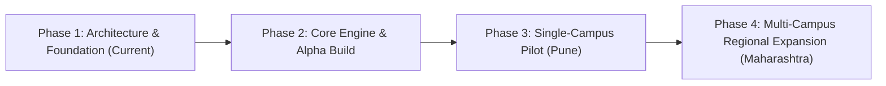

# QuickBite — Project Overview

> **Version:** 1.0.0  
> **Milestone:** 03 — Official Project Documentation  
> **Target Region:** Colleges & Universities across Maharashtra, India  

---

## 1. Executive Summary

**QuickBite** is an integrated smart canteen ordering and queue management platform engineered to resolve chronic dining congestion on higher education campuses. By replacing physical cash counters and chaotic queues with mobile advance ordering, real-time kitchen status synchronization, and digital pickup tokens, QuickBite provides students with an effortless dining experience while giving canteen vendors tools to maximize throughput and minimize food waste.

---

## 2. Mission & Strategic Vision

### Mission
To return valuable break and study time to students by eradicating physical queue delays through modern, reliable, and delightful mobile technology.

### Vision
To establish QuickBite as the premier campus dining operating system across collegiate institutions in Maharashtra, paving the way for digital, cashless, and intelligent food service throughout India's higher education network.

---

## 3. Market Landscape & Target Geography

### Geographical Focus: Maharashtra Higher Education Hubs
Maharashtra is home to one of India's largest concentrations of university campuses, technical institutes, and autonomous colleges. Key focus hubs include:
* **Pune:** Known as the "Oxford of the East," harboring major engineering, management, and arts campuses (COEP, MIT-WPU, PICT, Symbiosis, Bharati Vidyapeeth, Fergusson).
* **Mumbai & Navi Mumbai:** Dense urban campuses with extreme time pressure and compact canteen footprints (VJTI, SPIT, DJ Sanghvi, IIT Bombay vicinity colleges).
* **Nagpur, Nashik, & Chhatrapati Sambhaji Nagar:** Rapidly expanding educational clusters with large centralized student cafeterias.

### Campus Characteristics
* Typical student enrollment: 2,500 – 15,000 students per campus.
* Recess windows: Rigid 15–30 minute periods between lecture blocks.
* Canteen infrastructure: 1 to 4 independent stalls/canteens per campus serving breakfast snacks, thalis, fast food, and beverages.

---

## 4. Problem Analysis & Opportunity

### Current Reality in Campus Canteens
```text
+-----------------------+     +------------------------+     +-------------------------+
| Break Bell Rings      | --> | 800+ Students Rush to  | --> | Manual Chit Ordering    |
| (12:45 PM)            |     | Single Counter         |     | & Payment Confusion     |
+-----------------------+     +------------------------+     +-------------------------+
                                                                         |
                                                                         v
+-----------------------+     +------------------------+     +-------------------------+
| Cold Food or Missed   | <-- | Yelling Token Numbers  | <-- | 20-Minute Kitchen Queue |
| Lunch / Next Lecture  |     | Over Loud Crowd Noise  |     | Bottleneck              |
+-----------------------+     +------------------------+     +-------------------------+
```

### Critical Pain Points
1. **Student Time Deprivation:** Over 60% of student recess time is squandered standing in static queues or awaiting food preparation.
2. **Order Chaos & Lost Revenue:** Peak demand overwhelms staff, resulting in mismanaged chits, dropped orders, stockouts of popular items, and walkaways.
3. **Payment Inefficiencies:** Cash change shortages and unverified UPI transfer screenshots create administrative delays and fraud vulnerabilities.
4. **Lack of Demand Forecasting:** Canteens prepare food based on crude intuition, leading to evening waste of perishables and mid-day shortages of staple snacks (e.g., Poha, Misal Pav, Vada Pav, Sandwiches).

---

## 5. Target User Personas

### Persona A: The Time-Pressed Engineering Student ("Aditya")
* **Profile:** 3rd Year B.Tech Computer Science student in Pune.
* **Context:** Has a 20-minute gap between a Data Structures lab and a Theory of Computation lecture.
* **Goals:** Order Misal Pav and Chai quickly, know exactly when it will be hot and ready, collect it within 90 seconds, and eat without sprinting to class.
* **Frustrations:** Standing in a 30-person line only to discover Misal is finished when reaching the counter.

### Persona B: The Canteen Operations Lead ("Suresh Kaka")
* **Profile:** Primary food contractor managing a 600-meal/day campus canteen.
* **Context:** Employs 4 cooks and 2 counter assistants; faces massive surges at 11:00 AM, 1:15 PM, and 4:30 PM.
* **Goals:** Maximize ticket throughput, reduce order misplacement, track what to cook next, and get paid directly without manual ledger balancing.
* **Frustrations:** Students crowding counter glass, unpaid orders, delayed collections causing food to turn soggy or cold.

### Persona C: The Campus Administrator / Dean of Student Welfare
* **Profile:** Campus administrator responsible for student safety, hygiene, and campus satisfaction.
* **Goals:** Maintain organized, hygienic dining areas, avoid crowded safety hazards, and modernize campus infrastructure.
* **Frustrations:** Overcrowded hallways, physical clashes during peak lunch breaks, complaints about canteen service speed.

---

## 6. Core Value Propositions

| Stakeholder | Value Proposition |
| :--- | :--- |
| **Students** | Zero-queue ordering; advance meal booking from classroom; live preparation tracking; instant digital tokens; seamless UPI payment. |
| **Canteen Vendors** | Digital order orchestration; reduced counter congestion; live inventory toggles; predictable order batches; automated revenue accounting. |
| **Colleges & Universities** | Safer, dignified student dining environment; cashless campus compliance; enhanced prospective student appeal. |

---

## 7. Key Performance Indicators (KPIs)

To evaluate platform success during pilot and production rollouts, QuickBite tracks:
* **Average Pickup Wait Time:** Reduce from 18+ minutes to < 2.5 minutes at the physical counter.
* **Order Throughput Peak Capacity:** Increase peak-hour order processing capacity by at least 45%.
* **Order Accuracy Rate:** Attain 99.2%+ error-free order fulfillment.
* **Student Retention & Frequency:** Measure weekly repeat orders per active student (target: > 3.5 orders/week).
* **Payment Settlement Success:** > 99.5% instant verification via UPI deep links.

---

## 8. Strategic Phased Rollout Plan



1. **Phase 1: Architecture & Foundation (Current Milestone 03)**
   * Complete technical specifications, design tokens, data models, and repository foundations.
2. **Phase 2: Core Engine & Alpha Prototype**
   * Implement student ordering flow, Supabase real-time KDS, and digital token lifecycle.
3. **Phase 3: Single-Campus Controlled Pilot (Pune)**
   * Deploy in 1 selected engineering college canteen with 1,500 active students. Gather telemetry on peak latency, token scanning, and vendor usability.
4. **Phase 4: Multi-Campus Regional Expansion**
   * Onboard college clusters in Pune, Mumbai, and Nashik, introducing multi-stall campus food courts and administrative analytics.

---

## 9. Current Implementation Status

| Stage | Status | Notes |
| :--- | :--- | :--- |
| **Workspace & Structure** | **Complete** | Standardized monorepo layout configured with npm workspaces. |
| **Official Documentation** | **Complete** | Specs, PRD, Architecture, Design System, ADRs, Log. |
| **Monorepo Configuration** | **Complete** | Root `package.json`, `tsconfig.base.json`, `.editorconfig`. |
| **Application Development** | **Planned (Pending)** | Scaffolding scheduled for Milestone 07+. |
